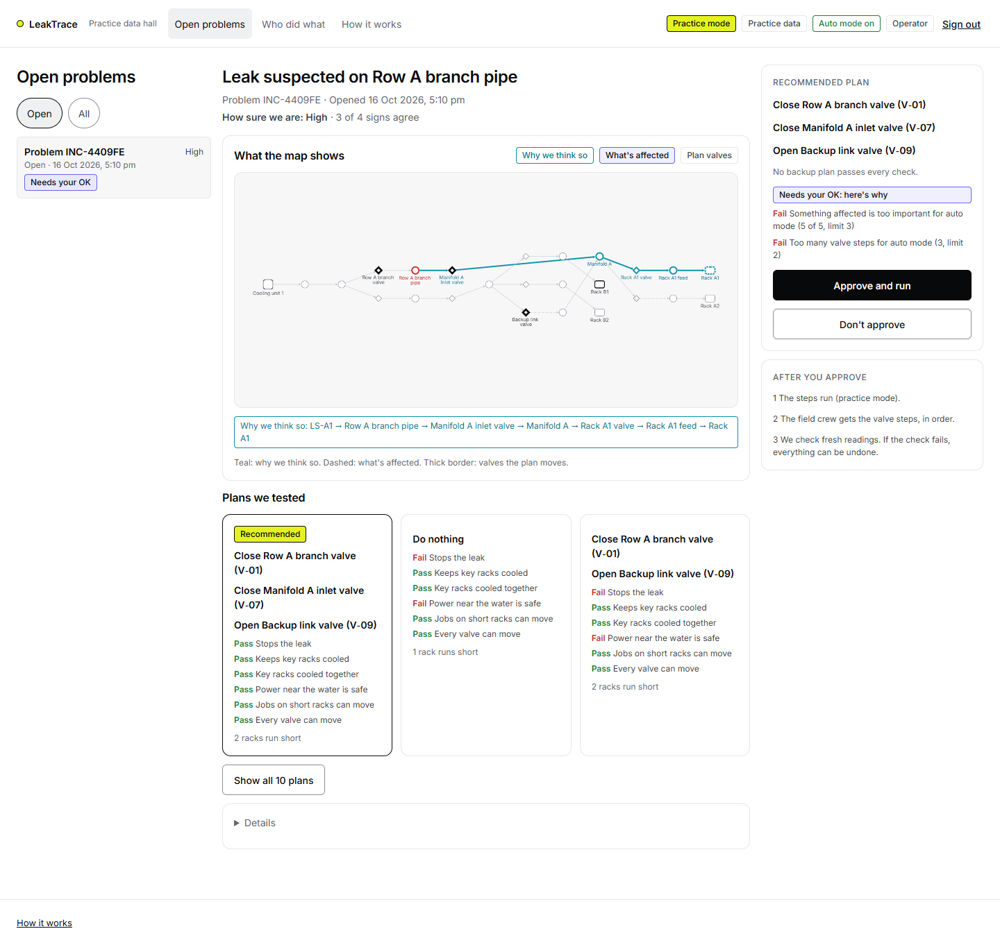
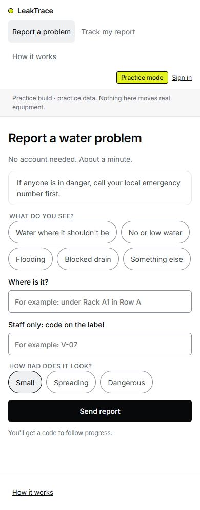
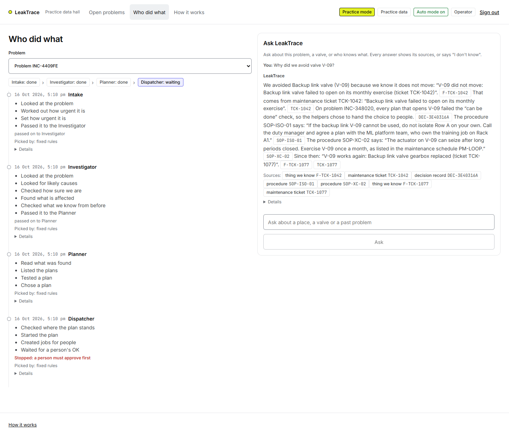
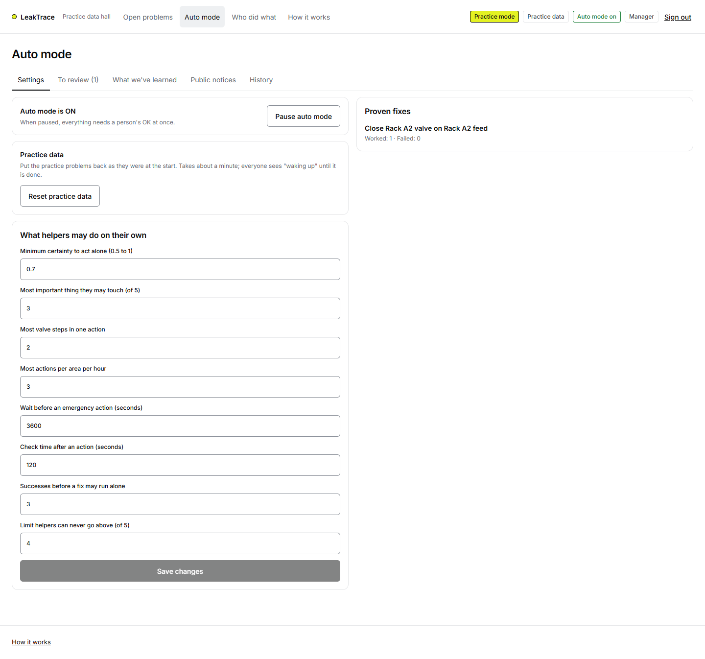

# LeakTrace

**When water or coolant goes where it should not, LeakTrace finds the likely leak, tests every valve plan on a FalkorDB graph, acts within strict limits or asks a person, checks the result, and remembers what happened.**

- **Demo video:** https://youtu.be/au1HP8HGY68

  [](https://youtu.be/au1HP8HGY68)

- **How it works page** (in the app, no sign-in): live counts from FalkorDB, the saved searches behind one real problem, and a button that runs each one on the live map

Everything here is practice data on a simulated data-hall cooling loop. No real equipment is connected; valves, meters and the field crew are simulated.

## The problem

In a liquid-cooled data hall, a leak is usually noticed first by a sensor or a person. The explanation is spread across meters, the pipe map, maintenance history and reports. Closing the nearest valve can cut cooling to a rack that must keep running; doing nothing lets the water spread near live power. Operators work this out by hand, under time pressure.

## What LeakTrace does

1. **Takes in** sensor readings and reports in plain words ("water under Rack A1 in Row A") and links them to the map.
2. **Finds the likely leak** and how sure it is, from independent signs (leak alarm, pressure drop downstream, missing water between meters, reports).
3. **Traces what is affected** several links away: racks, the jobs running on them, the teams that own those jobs, live power nearby.
4. **Tests every valve plan** with FalkorDB's max-flow algorithm: does the leak get no water, and does every rack that must keep running still get enough?
5. **Commits to one plan** and decides how much it may do alone: handled automatically (low risk, every condition met), needs a person's OK (and says why), or people decide.
6. **Carries it out** through a simulated field crew in a safe order, **checks** fresh readings, and **undoes** it if the check fails.
7. **Remembers**: a valve that would not move, a fix that worked, who did what. The next plan changes because of it.
8. **Answers questions with sources** (Ask LeakTrace): "Why did we avoid valve V-09?" comes back with the maintenance ticket, the thing we know and the procedure, or "I don't know".

## Why a graph

**Stop FalkorDB and LeakTrace has nothing to say.** Every route answers `503` with the reason (`not_reachable` or `graph_empty`), the command line exits with code 2, and the How it works page shows an error and no numbers. Nothing is cached (tests: `tests/test_kill_switch.py`, `tests/test_health.py`, `tests/test_how_it_works.py`; with `LEAKTRACE_KILLSWITCH_DOCKER=1` the same file stops the real container in the middle of carrying out a plan).

**The same cases decided four ways, scored in our own simulator on practice data** (`python -m scenario_generator.evaluate --seeds 5`; the simulator `scenario_generator/plant.py` knows nothing about the app). Each arm sees the same evidence, the alarmed leak sensor and its pipe section:

- **graph**: LeakTrace through its API: likely causes, what is affected several links away, every plan tested with max flow against its checks, what it remembers, and the auto-mode limits
- **flat**: a fixed rule on flat tables, not LeakTrace's checks: close the valves next to the suspected section, count only racks fed directly by it, skip a valve with an open failed-to-operate ticket; one lookup per table, no paths, no max flow
- **B1**: close the nearest valve upstream of the suspected section
- **B2**: isolate the whole loop (close every open valve)

| Case | Arm | Leak stopped | Runs with a key rack short | Racks short (avg) | Valve moves (avg) | Asked a person | Searches or lookups (avg) | Max-flow runs (avg) |
|---|---|---|---|---|---|---|---|---|
| S1 | graph | 5 of 5 | 0 of 5 | 2.0 | 3.0 | 5 of 5 | 141 | 49 |
| S1 | flat | 5 of 5 | 5 of 5 | 2.0 | 2.0 | 0 of 5 | 5 | 0 |
| S1 | B1 | 5 of 5 | 5 of 5 | 2.0 | 1.0 | 0 of 5 | 2 | 0 |
| S1 | B2 | 5 of 5 | 5 of 5 | 4.0 | 8.0 | 0 of 5 | 1 | 0 |
| S5 | graph | 5 of 5 | 0 of 5 | 1.0 | 1.0 | 0 of 5 | 118 | 21 |
| S5 | flat | 5 of 5 | 0 of 5 | 1.0 | 1.0 | 0 of 5 | 5 | 0 |
| S5 | B1 | 5 of 5 | 0 of 5 | 1.0 | 1.0 | 0 of 5 | 2 | 0 |
| S5 | B2 | 5 of 5 | 5 of 5 | 4.0 | 8.0 | 0 of 5 | 1 | 0 |
| S3 | graph | 0 of 5 | 0 of 5 | 0.2 | 0.0 | 5 of 5 | 136 | 49 |
| S3 | flat | 5 of 5 | 5 of 5 | 2.0 | 2.0 | 0 of 5 | 5 | 0 |
| S3 | B1 | 5 of 5 | 5 of 5 | 2.0 | 1.0 | 0 of 5 | 2 | 0 |
| S3 | B2 | 5 of 5 | 5 of 5 | 4.0 | 8.0 | 0 of 5 | 1 | 0 |

Cases: S1: leak on the Row A branch pipe; S5: small leak on the Rack A2 feed; S3: S1 with the backup link valve V-09 known stuck and really stuck. Key racks are criticality 5 (Rack A1, Rack B1). Run 2026-10-16T11:34:55Z, 5 seeds per case, 15.3 s. Scored by our own simulator (scenario_generator/plant.py) on practice data, not real equipment; a plan that needs a person's OK is scored as if approved.

What the numbers show, and no more:

- **S1**: LeakTrace stopped the leak in 5 of 5 runs with a key rack short in 0; the flat-table rule and B1 left a key rack short in 5 and 5. Its plan needs a person's OK.
- **S5**: No difference: LeakTrace, the flat-table rule and B1 made the same moves with the same result.
- **S3**: LeakTrace avoids starving the key rack and asks a person; it does not stop the leak on its own. The others stop the leak and leave a key rack short in 5 of 5 runs (flat) and 5 of 5 (B1).

LeakTrace does far more work per decision (118 to 141 searches on average, including 21 to 49 max-flow runs). The same table is on the How it works page, read from `app/data/evaluation.json`. Not run: a language model working from flat tables.

## Architecture

```
 Browser (React + Vite + Cytoscape; every word in web/src/copy.ts)
    |  REST, same origin
 FastAPI ── sign-in (one graph per customer, bound to the signed token)
    ├─ intake: reports, readings
    ├─ six helpers: Intake → Investigator → Planner → Dispatcher → Checker → Record keeper
    │     hand work to each other only through Task nodes in the graph
    ├─ domain rules in code: how sure we are, plan checks, what may be done alone
    ├─ Ask LeakTrace: graph searches + passage search, citations checked in code
    ├─ simulated valves and notices (practice mode)
    └─ MCP tool server (read-only domain tools)
           |
 FalkorDB 6.0.2: the system of record (map, reports, readings, plans, decisions, approvals,
                 jobs, memory, documents, tickets, chats, policies, users)
```

`scenario_generator/` produces practice data and drives scenarios through the same REST API; `app/` never imports it (`tests/test_import_guard.py`, which also bans other graph libraries).

## Graph model

One graph per customer, named `lt_<customer>`. Every network and registry node also has the label `Entity`, with an index on `id`. All practice data carries `source: 'synthetic'`.

| Nodes | Meaning |
|---|---|
| `Source`, `Junction`, `Segment`, `Valve`, `Consumer` | The flow network: cooling unit, header and manifolds, pipe sections, valves (`state`, `reversible`, `locked`), racks (`criticality`, `required_flow`) |
| `Zone`, `Sensor`, `Meter`, `PDU`, `Reading` | Location, leak and pressure sensors, flow meters, power feeds, recent readings |
| `Workload`, `Team`, `Person`, `User` | Jobs on each rack, teams, people, sign-in accounts (hashed passwords) |
| `Report`, `Incident`, `Option`, `Decision`, `AuthorityPolicy` | Reports, problems, plans with their checks, committed decisions (with a fingerprint of the graph they were made on), what helpers may do alone |
| `Approval`, `Execution`, `Action`, `Verification`, `AuditEvent` | Who approved and until when; one run of a plan with the exact prior valve states; each valve change; the check against fresh readings; one record per state change |
| `Task`, `Agent`, `Episode` | Work steps (helper steps, valve moves with lease and idempotency key), the helpers, a record of every tool call |
| `Fact`, `Playbook`, `Review` | Things we know (for example "V-09 does not move"), plans that worked before on a section, items a manager must check |
| `Document` (procedures also `SOP`), `Ticket`, `Chunk`, `Conversation`, `Message`, `WorkOrder`, `IncidentReport` | Documents, maintenance tickets, passages with their vectors, shift chats and each person's conversations with Ask LeakTrace, jobs for people, the incident report |

| Relationships | Meaning |
|---|---|
| `(a)-[:FLOWS_TO {dir, cap_base, open_cap, valve_id}]->(b)` | A flow link. A two-way pipe has a `normal` and a `reverse` edge (backfeed). `cap_base` is the capacity now (0 behind a closed valve) |
| `MONITORS`, `MEASURES`, `IN_ZONE`, `LOCATED_IN`, `ADJACENT_TO`, `RUNS_ON`, `POWERED_BY`, `OWNS`, `MEMBER_OF` | Instruments, location, dependencies, ownership |
| `ABOUT`, `PART_OF`, `INVOLVED`, `HAS_OPTION`, `DECIDED`, `CHOSE`, `OPERATES`, `JUSTIFIED_BY` | Reports and problems; plans, the decision, the valves a plan moves, the evidence behind it |
| `APPROVES`, `IMPLEMENTS`, `AUTHORIZED_BY`, `VERIFIES` | Carrying a decision out, and what allowed it |
| `FOR`, `CLAIMED_BY`, `HANDED_OFF_TO`, `OF` | Work steps for a problem, who took them, the hand-off chain, the audit trail |
| `EVIDENCED_BY`, `SUPERSEDES`, `DERIVED_FROM`, `ON` | What a fact rests on, what replaced what, where a job or playbook came from |
| `PERFORMED`, `EXPERT_IN {score, basis}`, `MENTIONS`, `AUTHORED`, `IN`, `WITH` | Who did a ticket, who knows an asset (from their tickets), what a text names, chats and conversations |

## Key queries and algorithms

All query text lives in `app/graph/queries/*.cypher`, saved by name, with parameters kept separate. Reads run through `GRAPH.RO_QUERY` with a timeout, so a read can never write.

| Query | What it does | Decision it drives |
|---|---|---|
| `q1_find_suspects` | Pipe sections in a zone with a leak alarm, ranked by alarms on the section and pressure anomalies downstream | Where the leak probably is |
| `flow_balance_for_segment` | For each metered region around a section: inflow minus downstream outflow | Whether water is going missing there (a balanced region counts against a suspect) |
| `q2_trace_impact`, `evidence_path` | Racks downstream through open links (multi-hop), their jobs and owning teams, and the path shown on the map | What is affected and who to tell |
| `q3_exposure` | Racks in the same or an adjacent zone, with their power feeds | Whether live equipment is near the water |
| `q4_recall_incidents`, `asset_flags` | Earlier problems on the same equipment; locked, irreversible or "stuck" valves | Whether memory rules a plan out |
| `boundary_valves` | The first valves met walking out from a section in each direction | Which valves can cut the section off |
| `max_flow` (`algo.maxFlow`) | Maximum flow to one target under a plan's temporary capacities | Whether the leak gets no water; whether each key rack (alone, then together) still gets enough |
| `policy_for_zone`, `actions_recent_in_zone` | The active auto-mode policy and recent actions | How much may be done without a person |
| `world_snapshot` | Everything a plan depends on, in one read | Whether an approved plan is still valid when it is about to run |
| `decision_transition`, `execution_start`, `move_done`, `move_failed`, `rollback_start` | Conditional state changes, each with its audit record, in one atomic write | Who may move a plan forward; that valves move in a safe order; undo to the exact prior state |
| `agent_task_claim`, `move_task_claim` | Conditional write: exactly one worker picks up a step | Helpers and crew never do the same step twice |
| `brain_decisions_mentioning`, `brain_facts`, `brain_docs_mentioning` | Decisions whose plans failed because of a valve, the facts they cite, the ticket behind each fact, procedures naming the valve | Ask LeakTrace: "why did we avoid V-09?" |
| `brain_owners`, `brain_experts` | Teams owning an asset (directly or through jobs on a rack); people with `EXPERT_IN` from their tickets | Who to call |
| `brain_passages` (`db.idx.vector.queryNodes`) | Nearest passages in the vector index | Passages for a question no direct link answers |
| `brain_fact_supersede` | A newer fact replaces older ones (kept, marked superseded) | A repaired valve can be planned on again |

**Testing a plan.** Each plan writes a temporary capacity on every flow link (closed valve 0, opened valve its open capacity, links into a rack capped at what it needs) and `algo.maxFlow` runs with that capacity; the property is removed afterwards. Its name travels only inside a parameter map, never in query text.

**How sure we are** (`app/domain/confidence.py`) is a fixed formula over graph counts: leak alarm on the section 0.35, pressure anomaly downstream 0.20, missing water in the metered region 0.25, first report 0.10, second reporter 0.10, a balanced region −0.30; with fewer than two kinds of sign it is capped at 0.40. One sign alone never leads to action: LeakTrace asks for an on-site check instead.

## What the helpers may do on their own

Computed in code (`app/domain/authority.py`) from graph facts. A plan is handled automatically only if all eight conditions hold:

1. An active policy covers the zone and auto mode is not paused.
2. How sure we are is high enough and nothing contradicts it.
3. No rack that must keep running loses flow.
4. Nothing affected is above the criticality ceiling.
5. Every valve move can be undone, and none is locked or known stuck.
6. The plan stays within the move limit and the zone's hourly action limit.
7. Nothing affects life safety.
8. An undo plan and a check are ready.

Otherwise it **needs a person's OK** and the screen lists the conditions that failed, or, if no plan passes every check, **people decide**. A person cannot approve their own request; approvals expire. Before anything moves, the plan's graph fingerprint is checked again; if the map changed, the plan is replaced. Valves that open go first, then the ones that close; commands carry idempotency keys; a crew member whose lease ran out cannot report. A low-risk plan whose check fails is undone automatically and planned again with a person's OK. An **emergency path** may act on the smallest isolating plan after a long wait with a leak near live power, but only if it starves no key rack, rests on enough evidence and auto mode is not paused; it always leaves a review item. **Earned autonomy**: a plan that worked three times on the same section may go one step above the usual ceiling, never above the manager's ceiling. The helpers cannot change policies, approve, or undo.

## What it remembers, and Ask LeakTrace

- **What happened** (`Episode`): every tool call, decision, approval, move and check.
- **Things we know** (`Fact`): a valve the crew reported stuck, a valve a maintenance ticket says failed to operate. Each rests on its evidence (`EVIDENCED_BY`); a repair ticket replaces it (`SUPERSEDES`), never deletes it. A replaced fact cannot be confirmed back.
- **Proven fixes** (`Playbook`): successes and failures of a plan on a section.
- **Conversations** (`Conversation`, `Message`): each person's questions and answers per problem, resumed after a restart.

**Ask LeakTrace** reads documents, maintenance tickets and shift chats into the same graph (no language model): each text is linked to the map by exact id or name; a name that looks like a map id but matches nothing goes to a manager to check. To answer, it picks a saved search by the question's words (why a valve was avoided, who owns it, who knows it, what we know about it, otherwise passages from the vector index) and words the answer with fixed sentences, each claim followed by its `[id]`. **Code then checks every citation**: each id must exist on this customer's map and be among the search results, and there must be at least one; otherwise the answer is "I don't know", with an offer to send the field crew a "find out" job. The passage vectors are hashed word counts computed locally, so the passage search finds passages that share the question's words, not passages that mean the same thing in other words.

On the practice data, "Why did we avoid valve V-09?" cites ticket `TCK-1042`, the thing we know `F-TCK-1042`, the decision that handed the choice to people, and procedures `SOP-ISO-01` and `SOP-XC-02`. After the repair ticket `TCK-1077` is read in, "What do we know about V-09?" says the earlier record no longer holds, and planning the same problem again uses V-09. "What is the capital of France?" gets "I don't know" (`tests/test_ask_leaktrace.py`).

## The helpers and who chooses their steps

Six helpers (Intake, Investigator, Planner, Dispatcher, Checker, Record keeper) pick up steps of their kind from `Task` nodes, use only their own tools, and hand on by creating the next `Task` (`HANDED_OFF_TO`), so the hand-off chain is read straight from the graph and survives any helper process being restarted.

**Fixed rules chose the helpers' steps in the demo and in every result in this README.** A language model can choose them instead, through any OpenAI-compatible provider (`LLM_BASE_URL`, `LLM_API_KEY`, `LLM_MODEL`; no vendor SDK); when it times out, is busy, hits a rate limit, answers unusably or reaches its call cap, the rules take over, and every step records which one chose it. We tried this once with a free-tier key (`gemini-flash-latest`, 2026-10-16), S1, S2 and S5 once each plus one retry: the provider was mostly unavailable (HTTP 503 "high demand", then 429 quota), the model chose 1 of 85 steps in each attempt, the rules took the rest, and all three cases still finished correctly.

Whatever chooses, authority stays in code: a helper can only call its own tools, the Planner cannot commit before testing every plan, a plan that needs approval is refused until a person approves it, and no helper can approve, undo or change the policy.

**Tools the agents use.** The helpers' tools are domain tools over saved searches (find suspects, trace impact, recall memory, list plans, test a plan, commit, start the plan, create jobs, check the result, write the report). The MCP server (`python -m app.mcp_server.server`, stdio, one customer bound by `LEAKTRACE_TENANT` on the server) exposes read-only tools: `find_suspects`, `trace_impact`, `execution_status`, `ask_leaktrace`. No tool takes a customer name and none can approve, execute or undo.

## The screens

Six screens in plain words; every word is in `web/src/copy.ts`, every colour in `web/src/theme.css`, checked by lints. "Practice mode" shows on every screen.

| Screen | Who | What it shows |
|---|---|---|
| Report a problem, Track my report | anyone | A short form, then a code and five plain stages, plus "I see this too". No internal ids leave the server |
| Open problems | operator, manager, safety officer | The queue; how sure we are; the map with the "why we think so" path and what is affected; every plan with Pass or Fail per check; why it needs your OK; approve and run, the valve steps, the check, undo |
| My jobs | field crew | Valve steps to pick up, mark done or report "it won't move"; jobs with step-by-step confirmation |
| Auto mode | manager (others read only) | What helpers may do alone (bounded, audited), pause, what they did alone, things to review, what we've learned, proven fixes, **Reset practice data** |
| Who did what, Ask LeakTrace | operator, manager | The hand-off chain and each helper step, with who chose it; questions answered with sources |
| How it works | anyone | Live counts, six saved searches of one real problem with their plan and cost (run on the live map, read-only), the comparison above, the checks the test run saved |

## Screens


Open problems: the map with the "why we think so" path, every plan with Pass or Fail per check, and why the chosen plan needs a person's OK.


Report a problem: a short form anyone can fill in on a phone, no sign-in.


Who did what: each helper step and who chose it, with Ask LeakTrace answering "Why did we avoid valve V-09?" with its sources.


Auto mode: what helpers may do on their own, the pause switch, and the manager's Reset practice data button.

## Try it (judges)

- Run it locally (below). The first visit after a start shows "Waking up the practice map" until the practice data is ready.
- **Sign in** as `operator1` (open problems, approve a plan), `tech1` (field crew jobs), `staff1` or `safety1`. The sign-in screen shows the **shared practice password**. The manager account is private.
- "Report a problem", "Track my report" and "How it works" need no sign-in.
- Everything is practice data. It is rebuilt whenever the service starts after sleeping, and a manager can reset it.
- Approving the waiting plan works, but on the demo no simulated meters report after the valve steps, so its check ends as failed (see Limits); the problem marked "Handled automatically" shows a complete, verified run.

## Run locally

Requirements: Docker; for development also Python 3.11+ and Node 22.

**Everything in one container** (as deployed):

```bash
cp .env.example .env     # set LEAKTRACE_SECRET, LEAKTRACE_DEMO_PASSWORD (shared), LEAKTRACE_MANAGER_PASSWORD (private)
docker compose --profile app up -d --build    # FalkorDB + API + helpers + web app; open http://localhost:8080/
```

**For development** (Windows PowerShell; on macOS or Linux activate with `source .venv/bin/activate`):

```powershell
py -3.12 -m venv .venv; .\.venv\Scripts\Activate.ps1; pip install -r requirements.txt   # first time only
docker compose up -d                                   # 1. FalkorDB on localhost:6380 (browser UI on :3000)
.\.venv\Scripts\Activate.ps1                          # 2. in every new terminal
python -m scenario_generator.demo --tenant demo        # 3. the practice data (resets the demo customer)
cd web; npm install; npm run build; cd ..              # 4. the web app (again only after web/ changes)
python -m uvicorn app.api.main:app --port 8000         # 5. open http://localhost:8000/
```

`LEAKTRACE_SECRET` signs sign-in tokens; without it everyone is signed out on each restart.

## Troubleshooting

- **"Waking up the practice map" for a long time, or "Can't reach the map right now":** open `/health`. `falkordb_reachable: false`: FalkorDB is not running (`docker compose up -d`; `docker logs leaktrace-falkordb` says why it stopped). `demo_seeded: false`: the practice data is missing or still being built (run step 3, or wait for the container's start-up). The server log and the screen's Details drawer name the host, port and graph.
- **`No module named 'falkordb'`:** the Python environment is not active (step 2).
- **`Missing argument 'APP'`:** uvicorn needs `app.api.main:app` (step 5).
- **The container stops at start with "ensure-demo failed":** `LEAKTRACE_DEMO_PASSWORD` or `LEAKTRACE_MANAGER_PASSWORD` is not set.

## Deploy (Render, free web service)

Measured here under the same limits as Render's free instance (`docker run --cpus 0.1 --memory 512m`, no disk): memory peaked at 140.8 MiB of 512 MB (idle about 95.4 MiB); one decision took 1.7 s (median of 3); a full S1 run took 5.5 to 7.7 s; from container start the waking page answered after 26.4 s and the practice data was ready after 46.0 s. Render's own docs do not say whether a Dockerfile service may use the Free instance type (third-party guides show it working); check when creating the service.

1. In Render, **New → Web Service → Build and deploy from a Git repository**, connect GitHub and pick this repository, branch `main`.
2. **Language: Docker**. **Dockerfile Path: `deploy/Dockerfile`** (build context: the repository root).
3. **Instance type: Free.**
4. **Environment variables:**

   | Name | Value | Secret? |
   |---|---|---|
   | `LEAKTRACE_SECRET` | a long random value (Render's "Generate" button) | yes |
   | `LEAKTRACE_MANAGER_PASSWORD` | a private password for `manager1` | yes |
   | `LEAKTRACE_DEMO_PASSWORD` | the shared practice password judges will see on the sign-in screen (pick something easy to type) | no: it is public by design, practice data only |

   Do not set `LLM_*` (the fixed rules choose the steps). Render sets `PORT` itself.
5. **Advanced → Health Check Path: `/public/info`** (not `/health`, which answers 503 on purpose while the practice data is being rebuilt).
6. **Create Web Service**, wait for the build, open the `onrender.com` address. The first load shows "Waking up the practice map" until the practice data is ready.

Render's free web services sleep after 15 minutes without traffic and take about a minute to wake; their filesystem is not kept, so every wake starts with fresh practice data.

## Scenarios and how to reproduce them

All practice data; every step goes through the REST API.

| Scenario | Command | What happens |
|---|---|---|
| S1: leak near a key rack | `python -m scenario_generator.run s1 --tenant demo --seed 7 --reset --execute happy` | The nearest valve would starve Rack A1; the chosen plan opens the backup link V-09 first, then closes V-01 and V-07. It needs a person's OK (Rack A1 is above the ceiling; 3 moves where 2 are allowed); after approval the crew moves the valves and fresh readings verify it |
| S1 variants | `--execute stuck_v09`, `stuck_v07`, `worker_dies`, `graph_changes`, `approval_expires` | A stuck valve stops the plan (undone exactly, a new plan avoids it); a crew member vanishes (lease, another finishes, 3 physical moves); the leak grows after approval (refused as stale, re-planned); the approval runs out |
| S2: ambiguous evidence | `python -m scenario_generator.run s2 --tenant demo --seed 7 --reset --helpers evidence` | One sign alone: asks for an on-site check, tests no plans |
| S3: valve known stuck | `pytest tests/test_restart_recall.py` | After every helper process has ended, a new leak on the same pipe recalls the stuck V-09 and the decision hands the choice to people |
| S5: low-risk leak | `python -m scenario_generator.run s5 --tenant demo --seed 7 --reset --execute auto` | Handled automatically and verified with no person; `passing_valve`: the check fails and the plan is undone automatically |
| S9: answers with sources | `python -m scenario_generator.knowledge --tenant s9demo --reset` | Reads the practice documents, tickets and chats, avoids V-09, answers the questions above, then the repair update changes the answers |
| Helpers | add `--helpers approve` (S1), `--helpers auto` (S5); `--helper-process` runs each round as a new process | The six helpers do the work through task nodes |
| The comparison | `python -m scenario_generator.evaluate --seeds 5` | The table above |

## Results

Everything below ran on Windows 11, Docker Desktop, FalkorDB 6.0.2, Python 3.12.8.

- **Tests:** `pytest -q` against a live FalkorDB: 278 tests on 2026-10-16: 276 passed in the full run (4 min 9 s), and the 2 opt-in tests that stop the real FalkorDB container passed separately with LEAKTRACE_KILLSWITCH_DOCKER=1. They include the stop switch, the import guard, every auto-mode condition alone, approvals, the stale-plan guard, exact undo, claim races, customers isolated by token, S1 on five seeds, the helpers' hand-offs and restart recall, Ask LeakTrace citations and refusals, the knowledge update, judge access, and lints for plain words, colours and public wording.
- **The comparison** above (5 seeds per case, our own simulator, practice data).
- **One container:** under 0.1 CPU and 512 MB, peak memory 140.8 MiB, one decision 1.7 s, a full S1 run 5.5-7.7 s (all 5 verified), ready 46.0 s after start.
- **Model:** fixed rules chose every step in these results; the free-tier model run is described above.

## Limits

- Practice data only, on one simulated cooling loop (8 pipe sections, 9 valves, 4 racks); no real equipment, no real notifications.
- After a person approves a plan in the demo, the field crew's valve steps work, but the demo does not post simulated meter readings afterwards, so the check may mark the plan failed after 2 minutes. The full loop (approve, move, fresh readings, verified) runs in the scenario commands below and produced the practice data's "handled automatically" problem.
- The flow model is a capacity network (max flow), not hydraulics.
- The passage search is word-based (hashed word counts), not a semantic model; direct graph links carry the important answers.
- The comparison is scored in our own simulator, and the flat-table arm is a fixed rule, not LeakTrace's checks rebuilt without a graph.
- Not built: public notices for a safety officer, photo upload, the public-water and factory networks, a dark theme.
- FalkorDB 6.0.2 crashed once during development (a panic inside FalkorDB, not reproduced in 6 seeds and 15,413 concurrent requests); the setup now restarts it and keeps an append-only file.
- A language model choosing the steps has not been shown to work beyond the free-tier run above.

## AI assistance

Claude Code wrote most of the code and tests. Claude chat was used for planning, wireframes and prompts. I reviewed and ran the code, and I can explain the code and the decisions behind it. The demo runs on practice data.

---

Built for Graph Hacks 2026, Track 1: Agents That Act on Connected Data.
